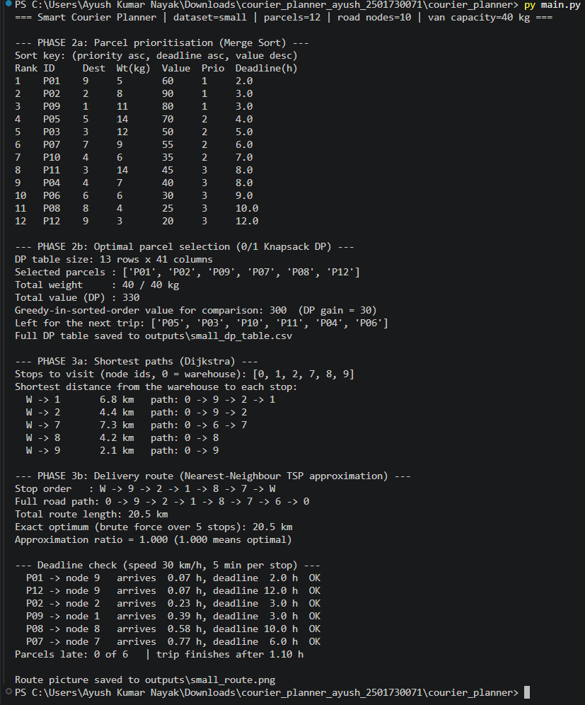
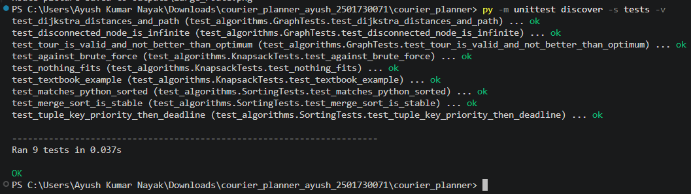

# Smart Courier Planner (DAA Capstone)

An intelligent courier-planning prototype that takes a list of parcels and a road
network and produces **(1)** a prioritised parcel list, **(2)** an optimal packing plan
for one van trip, and **(3)** an ordered delivery route - then measures the runtime of
every major step.

| | |
|---|---|
| **Student** | Ayush Kumar Nayak|
| **Roll No.** | 2501730071 |
| **Programme** | B.Tech CSE (AI & ML), 3rd Semester, Section C |
| **Course** | Design and Analysis of Algorithms (DAA) - Capstone |

## Algorithms used

| Step | Algorithm | Why | Complexity |
|---|---|---|---|
| Prioritise parcels | **Merge Sort** (stable, tuple key) | guaranteed O(n log n), stable ties | O(n log n) |
| Choose parcels for one trip | **0/1 Knapsack (Dynamic Programming)** | maximise value under van capacity | O(n * C) |
| Shortest road distances | **Dijkstra** (binary heap) | non-negative road lengths | O((V+E) log V) |
| Overall delivery route | **Nearest-Neighbour TSP** (approximation) | exact TSP is NP-hard | O(k^2) |

Pipeline:

```
parcels.csv --Merge Sort--> ranked list --Knapsack DP--> parcels for this trip
   --> delivery stops --Dijkstra from every stop--> distance matrix
   --> Nearest-Neighbour TSP --> stop order --> expanded road path + length
   --> deadline check --> route picture      (benchmark.py measures every step)
```

## Project structure

```
courier_planner/
├── main.py                  # runs Phases 2 + 3 end to end
├── requirements.txt
├── src/
│   ├── models.py            # Parcel dataclass
│   ├── data_loader.py       # CSV readers
│   ├── sorting.py           # merge sort (+ insertion / quick sort for comparison)
│   ├── knapsack.py          # 0/1 knapsack DP (+ greedy and brute force for checking)
│   ├── graph_routing.py     # Dijkstra, nearest-neighbour TSP, brute-force TSP
│   ├── generator.py         # random dataset generator
│   ├── benchmark.py         # Phase 4 runtime + quality experiments, charts
│   └── visualize.py         # route picture
├── datasets/                # small_* (hand made, 12 parcels) and large_* (generated, 40 parcels)
├── tests/test_algorithms.py # 9 unit tests
├── outputs/                 # run logs, DP tables, route pictures, runtime/quality charts + CSVs
├── docs/DESIGN.md           # Phase 1 design
├── docs/REPORT.md           # Phase 4/5 analysis and final report
└── screenshots/
```

## How to run (step by step)

1. Install Python 3.9 or newer (check with `python --version`).
2. Open a terminal in the project folder (the one containing `main.py`).
3. (Optional) create a virtual environment: `python -m venv .venv`, then activate it
   (Windows: `.venv\Scripts\activate`, macOS/Linux: `source .venv/bin/activate`).
4. Install the only dependency: `pip install -r requirements.txt`
5. Run the small dataset: `python main.py`
6. Run the larger dataset: `python main.py --dataset large`
7. Try another van capacity: `python main.py --capacity 30`
8. Run the correctness tests: `python -m unittest discover -s tests -v`
9. Run the runtime experiments (about 1 minute): `python -m src.benchmark`
10. (Optional) make a new random dataset:
    `python -m src.generator --prefix large --nodes 60 --parcels 40 --seed 7`

(On some systems use `python3` instead of `python`.)

## Dataset formats

* `*_nodes.csv`: `id,name,x,y` - node 0 is always the warehouse.
* `*_edges.csv`: `u,v,km` - undirected road between nodes u and v, length in km.
* `*_parcels.csv`: `pid,dest,weight,value,priority,deadline_h` - `dest` is a node id,
  `weight` is an integer in kg, `priority` 1 = urgent ... 3 = low, `deadline_h` in hours.

## Results (summary)

| Dataset | Selected value (DP) | Greedy value | Route length | NN / optimum |
|---|---|---|---|---|
| small (12 parcels, 40 kg) | 330 | 300 | 20.5 km | 1.000 (brute-force checked) |
| large (40 parcels, 60 kg) | 924 | 629 | 127.4 km | not computed (14 stops) |

Full outputs: `outputs/small_run_log.txt`, `outputs/large_run_log.txt`.
Charts: `outputs/runtime_chart.png`, `outputs/quality_chart.png`,
`outputs/small_route.png`, `outputs/large_route.png`.
See `docs/REPORT.md` for the analysis.

## Assumptions

* One van, one trip, starts and ends at the warehouse (node 0).
* Average speed 30 km/h and 5 minutes per stop (used only for the deadline check).
* Knapsack maximises the parcels' `value` score (priority-weighted revenue) within the weight capacity.
* Roads are two-way and lengths are non-negative.

## Screenshots

| Evidence | File |
|---|---|
| Small dataset run | `screenshots/01_run_small.png` |
| Large dataset run | `screenshots/02a_run_large.png`, `screenshots/02b_run_large.png` |
| Unit tests (all pass) | `screenshots/03_unit_tests.png` |
| Runtime benchmark | `screenshots/04a_benchmark_run.png`, `screenshots/04b_benchmark_run.png` |


